  
  
  

## About

I turn real-world workflows into dependable applications: API design, database integrity, cloud storage and deployment. Two internships (**BigIn**, **NETS**) taught me to own a system end to end. Next, I'm growing in system design and distributed systems.

| | |
|---|---|
| 🎯 **Focus** | Backend · Full-Stack · System Design |
| 🎓 **Education** | B.Sc. Information Technology, HUIT · GPA 3.35 / 4.0 |
| 🌐 **English** | VSTEP B2 |
| 📍 **Based in** | Ho Chi Minh City, Vietnam |
| 🏊 **Off the keyboard** | Swimming, running, badminton, basketball |

## Tech stack

<table>
  <tr>
    <td><b>Languages</b></td>
    <td></td>
  </tr>
  <tr>
    <td><b>Backend &amp; data</b></td>
    <td>
       
      
      
      
      
      
      
    </td>
  </tr>
  <tr>
    <td><b>Frontend &amp; mobile</b></td>
    <td></td>
  </tr>
  <tr>
    <td><b>DevOps &amp; cloud</b></td>
    <td></td>
  </tr>
  <tr>
    <td><b>Learning</b></td>
    <td></td>
  </tr>
</table>

## Experience

### Software Engineer Intern · BigIn
`Jun – Sep 2026` &nbsp;·&nbsp; **BigIn Asset Management** &nbsp;·&nbsp; [Live environment ↗](https://training-se-frontend.vercel.app/)

- **Sole developer** of an internal asset platform that replaced Excel tracking of devices for ~50 employees, which had caused lost assets and no accountability.
- **Concurrency-safe lifecycle:** handover, retrieval, damage reports and borrow/return use conditional updates inside transactions, so when two operations hit the same device, only one wins.
- **Auth:** Refresh Token Rotation (15-min access tokens) and flat multi-role RBAC, so abnormal sessions can be detected and invalidated.
- **Cloud storage:** evidence photos go straight to S3 via presigned URLs, with CloudFront in front and no public bucket access.
- **Notifications:** Transactional Outbox with a background worker and automatic retries.
- **Delivery:** Vue 3 + Pinia UI with permission-aware navigation, QR scanning and camera capture. Docker Compose and GitHub Actions (typecheck, 98 unit tests, security scan) gate every merge.

Express 5 · Vue 3 · Pinia · MariaDB · AWS S3 · CloudFront · Docker Compose · GitHub Actions · Vercel

### Backend & Mobile/Web Developer Intern · NETS Software Technology
`Jan – Mar 2026` &nbsp;·&nbsp; **Wayfindy & Wayfindy Business** &nbsp;·&nbsp; [wayfindy.com ↗](https://wayfindy.com/)

- Built features for the Angular business portal and the Flutter app, both on one shared API.
- Maintained geolocation and routing REST APIs, and tuned EF Core + SQL Server queries to speed up map and route retrieval.
- Practiced issue-driven development: aligned solutions with the Tech Lead before coding, which cut review rework.

ASP.NET Core · EF Core · SQL Server · Flutter · Angular · GitHub

## Projects

| Project | What it does | Stack |
|---|---|---|
| [**Anh Tho Spa**](https://github.com/Tuyen-ares/Spa-bookings_System) | Graduation project (team of 3): bookings, treatment courses, inventory and shifts. Managers confirm requests to prevent double-booking, and VNPay callbacks are checksum-verified. | Node.js · React · React Native · MySQL · Redux |
| [**Fruit CNN**](https://github.com/Tuyen-ares/fruit_cnn_auth) | Fruit image recognition with a CNN and MobileNetV2. | Python |
| [**Fast Food App**](https://github.com/Tuyen-ares/fastfood_nssql) | Food ordering with customer, shipper, admin and restaurant roles. | — |
| [**RFM K-means**](https://github.com/Tuyen-ares/RFM_Kmeans) | Customer segmentation using RFM features and K-means. | Python |

## Currently exploring: RabbitMQ

At BigIn I chose a **database worker + Transactional Outbox** over a message broker: at ~50 users it avoided extra infrastructure and still guaranteed no lost messages. Now I'm studying where a broker earns its place.

  

`exchanges & bindings` · `acks & retries` · `dead-letter queues` · `competing consumers`

## GitHub activity

  
  

---

  Have a problem worth solving? <a href="mailto:hoantuyen04@gmail.com"><b>Let's talk</b></a>.

